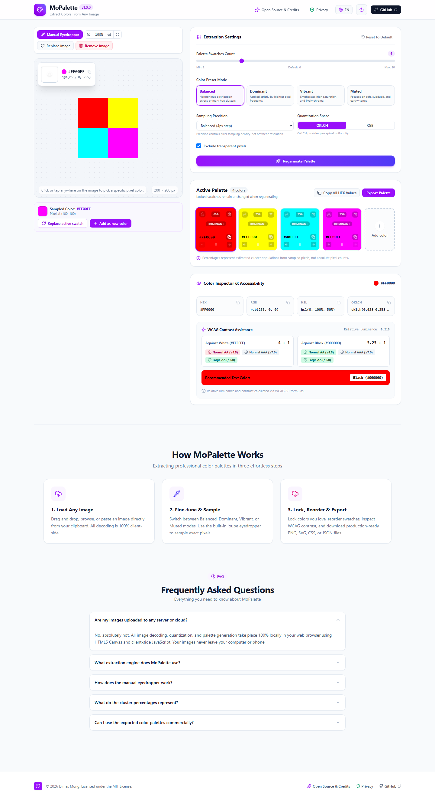
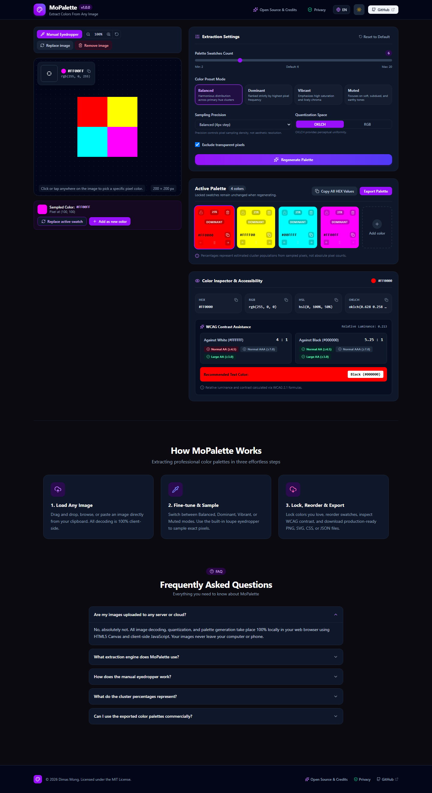
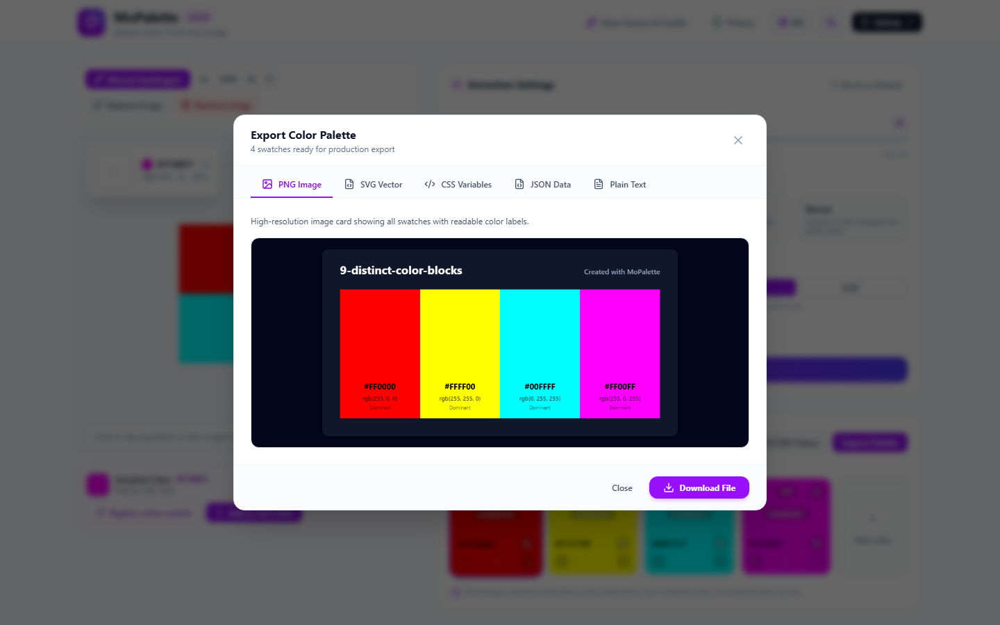
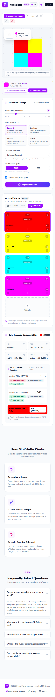

# MoPalette

> **Standalone Image Color Palette Extractor**  
> *Extract, refine, organize, and export color palettes from any image with 100% in-browser privacy.*

[](package.json)
[](LICENSE)
[](https://github.com/lokesh/color-thief)
[-brightgreen.svg)](vitest.config.ts)
[](https://playwright.dev/) [-brightgreen.svg)](playwright.config.ts)

---

## 🎨 Overview

**MoPalette** is an independent, single-purpose web application designed to excel at extracting, refining, and exporting color palettes from user-provided images.

- **One Website = One Primary Function:** MoPalette focuses strictly on high-quality color palette workflows. It does not contain unrelated image editors, compression, background removal, or conversion tools.
- **100% Client-Side Privacy:** Images are decoded directly in browser memory using HTML5 Canvas and browser APIs. Images are **never** uploaded to a server, cloud service, or third-party analytics API.
- **Genuine Open-Source Engine:** Extraction is powered by the maintained **Color Thief** library (`v3.5.0`) created by **Lokesh Dhakar**, supplemented by OKLCH quantization, semantic swatches, and pixel-exact Canvas `ImageData` sampling.

---

## 📸 Screenshots

| Desktop Light Workspace | Desktop Dark Workspace |
| :---: | :---: |
|  |  |

| Production Export Modal | Mobile Responsive Workspace |
| :---: | :---: |
|  |  |

---

## ✨ Key Capabilities

### 1. Automatic Palette Generation
- **Configurable Swatches:** 2 to 20 colors (default 6).
- **Extraction Presets:**
  - **Balanced:** Harmonious distribution across hue clusters.
  - **Dominant:** Ranked strictly by highest pixel frequency / cluster population.
  - **Vibrant:** Semantic vibrant swatches + high saturation.
  - **Muted:** Semantic muted swatches + subdued earthy tones.
- **Quantization Color Spaces:** OKLCH (perceptually uniform D65) or standard sRGB.
- **Sampling Accuracy:** Fast (10px step), Balanced (4px step), and High Accuracy (1px step).
- **Transparency Handling:** Full exclusion of transparent pixels (`alpha < 128`), preventing transparent areas from contaminating palettes with black or white.
- **Honest Metrics:** Discloses that cluster population and percentages are estimated representative populations from sampled pixels.

### 2. Interactive Eyedropper & Loupe Magnifier
- Pixel-accurate sampling directly from image buffer using Canvas `ImageData`.
- **Precise Coordinate Mapping:** Full handling of CSS `object-fit: contain`, container letterboxing, display scaling, and DPR.
- **11×11 Pixel Loupe Magnifier:** Zoomed retro-style grid highlighting the sampled pixel with central crosshair.
- Instant actions: Replace active swatch, add as new color, or copy HEX.

### 3. Palette Editor
- Lock/unlock swatches: **Locked swatches preserve their exact values and positions across regenerations.**
- Touch-friendly and desktop drag-and-drop reordering.
- Manual color editing: clears prior automatic image-population estimates so manual edits are not misrepresented.
- Add and remove swatches (maintains minimum 2, maximum 20).

### 4. Color Formats & Contrast Assistance
- Values for every swatch: **HEX**, **RGB**, **HSL**, and **OKLCH**.
- One-click copy with clipboard feedback toast.
- **WCAG 2.1 Contrast Assistance:**
  - Exact relative luminance ($0.0$ to $1.0$).
  - Contrast ratios against pure White (`#FFFFFF`) and Black (`#000000`).
  - WCAG AA (≥4.5:1) and AAA (≥7.0:1) normal text evaluation.
  - Large text (≥3.0:1 AA, ≥4.5:1 AAA) evaluation.
  - Suggested readable foreground text color (`#FFFFFF` or `#000000`).

### 5. Multi-Format Production Exports
- **PNG:** High-resolution card with swatches and auto-contrast color labels.
- **SVG:** Scalable vector graphic with `<rect>` elements and clean typography.
- **CSS:** Custom properties (`:root { --palette-1: #...; }`).
- **JSON:** Complete structured data including RGB, HSL, OKLCH, and contrast metrics.
- **TXT:** Simple newline-delimited HEX codes.

### 6. Bilingual & Theme System
- **Themes:** Default Light mode and Charcoal/Purple Dark mode with class-based tokens (`dark:`).
- **Languages:** English (default) and Bahasa Indonesia (alternative).
- User preferences persisted locally in `localStorage`.

---

## 🛠️ Tech Stack & Architecture

- **Framework:** React 19 + TypeScript
- **Bundler:** Vite 8
- **Styling:** Tailwind CSS v4 (`@tailwindcss/vite`)
- **Extraction Engine:** Color Thief `v3.5.0` (Lokesh Dhakar, MIT)
- **Icons:** Lucide React
- **Unit Testing:** Vitest (with jsdom)
- **E2E Testing:** Playwright (Chromium & Mobile Chrome)

### Modular Directory Structure

```text
MoPalette/
├── docs/screenshots/            # High-resolution desktop & mobile UI captures
├── public/                      # Static assets & SVG favicon
├── scripts/                     # Test fixtures generator & scripts
├── src/
│   ├── components/              # Isolated UI components
│   │   ├── ColorDetailPanel.tsx # WCAG contrast & format inspector
│   │   ├── ExportModal.tsx      # Multi-format production export modal
│   │   ├── FAQSection.tsx       # Frequently asked questions
│   │   ├── Footer.tsx           # Footer with attribution & privacy links
│   │   ├── Hero.tsx             # Main value proposition
│   │   ├── ImageWorkspace.tsx   # Image canvas, eyedropper & 11x11 loupe
│   │   ├── Navbar.tsx           # Top navigation, theme & language controls
│   │   ├── OpenSourceModal.tsx  # Attribution & license details
│   │   ├── PaletteControls.tsx  # Sliders, presets & precision settings
│   │   ├── PaletteSwatches.tsx  # Swatch cards, lock & reorder controls
│   │   ├── PrivacyModal.tsx     # 100% in-browser privacy policy
│   │   ├── UploadZone.tsx       # Drag-and-drop & paste upload zone
│   │   └── UsageExplanation.tsx # 3-step usage guide
│   ├── hooks/                   # Custom state hooks
│   │   ├── useClipboard.ts      # Clipboard copy with toast feedback
│   │   ├── useLanguage.ts       # Bilingual dictionary & toggle
│   │   ├── usePaletteState.ts   # Palette mutation & history state
│   │   └── useTheme.ts          # Class-based light/dark theme toggle
│   ├── lib/
│   │   ├── color/               # Core color engines
│   │   │   ├── conversions.ts   # Exact RGB <-> HEX, HSL, OKLCH, WCAG formulas
│   │   │   ├── extractor.ts     # Color Thief integration & presets
│   │   │   └── eyedropper.ts    # Coordinate mapping & pixel sampling
│   │   ├── export/              # Export generators
│   │   │   ├── downloadHelper.ts# Browser Blob download triggers
│   │   │   └── exportGenerators.ts # PNG, SVG, CSS, JSON, TXT builders
│   │   └── i18n/
│   │       └── translations.ts  # English & Indonesian strings
│   ├── test/                    # Test environment setup
│   ├── types/                   # TypeScript interfaces
│   ├── App.tsx                  # Root application workspace
│   ├── index.css                # Tailwind CSS v4 entry
│   └── main.tsx                 # React entrypoint
├── tests/
│   ├── e2e/                     # Playwright end-to-end tests
│   └── fixtures/                # 15 deterministic test images
├── package.json                 # Dependency lock & scripts
├── playwright.config.ts         # Playwright test runner configuration
├── vitest.config.ts             # Vitest test runner configuration
├── vercel.json                  # Vercel SPA routing configuration
├── THIRD_PARTY_NOTICES.md       # Upstream licenses & attributions
├── LICENSE                      # MIT License
└── README.md                    # Documentation
```

---

## 🧪 Testing & Verification

MoPalette strictly executes **real application code** with zero hardcoded success mocks.

### 15 Deterministic Test Fixtures
Generated under `tests/fixtures/`:
1. `1-solid-red.png` (Solid #FF0000)
2. `2-solid-green.png` (Solid #00FF00)
3. `3-solid-blue.png` (Solid #0000FF)
4. `4-pure-black.png` (Pure #000000)
5. `5-pure-white.png` (Pure #FFFFFF)
6. `6-split-red-blue-50-50.png` (50% red / 50% blue)
7. `7-split-red-blue-75-25.png` (75% red / 25% blue)
8. `8-grayscale-gradient.png` (Horizontal gradient)
9. `9-distinct-color-blocks.png` (4 distinct color blocks)
10. `10-fully-transparent.png` (100% alpha = 0)
11. `11-partially-transparent.png` (Half transparent, half purple)
12. `12-high-resolution.png` (1600×1200 geometric image)
13. `13-low-resolution-icon.png` (16×16 icon)
14. `14-corrupt-image.png` (Corrupted byte buffer)
15. `15-unsupported-format.txt` (Text file rejected gracefully)

### Automated Test Suites

```bash
# Run Vitest unit tests (36 tests passed)
npm test

# Run Playwright end-to-end browser tests (24 tests passed across Desktop & Mobile)
npm run test:e2e

# Run production build
npm run build
```

---

## 🔒 Privacy Guarantee

- **Zero Server Uploads:** All decoding and quantization occur strictly inside browser memory.
- **No Third-Party Analytics:** Zero advertising trackers, third-party cookies, or telemetry.
- **Local Preferences:** Only theme and language choices are stored in browser `localStorage`.

---

## 📜 Open Source & Attribution

- **Color Thief:** Created by **Lokesh Dhakar** (MIT License). Repository: https://github.com/lokesh/color-thief
- **Lucide Icons:** Created by Lucide Contributors (ISC License). Repository: https://github.com/lucide-icons/lucide
- **React:** Meta Platforms, Inc. (MIT License).
- **Tailwind CSS:** Tailwind Labs, Inc. (MIT License).
- **Vite:** Evan You & Vite Contributors (MIT License).

See [THIRD_PARTY_NOTICES.md](THIRD_PARTY_NOTICES.md) for complete upstream license notices.

---

## 📄 License

MoPalette is licensed under the **MIT License**. Copyright (c) 2026 Dimas Mong.  
See [LICENSE](LICENSE) for details.
